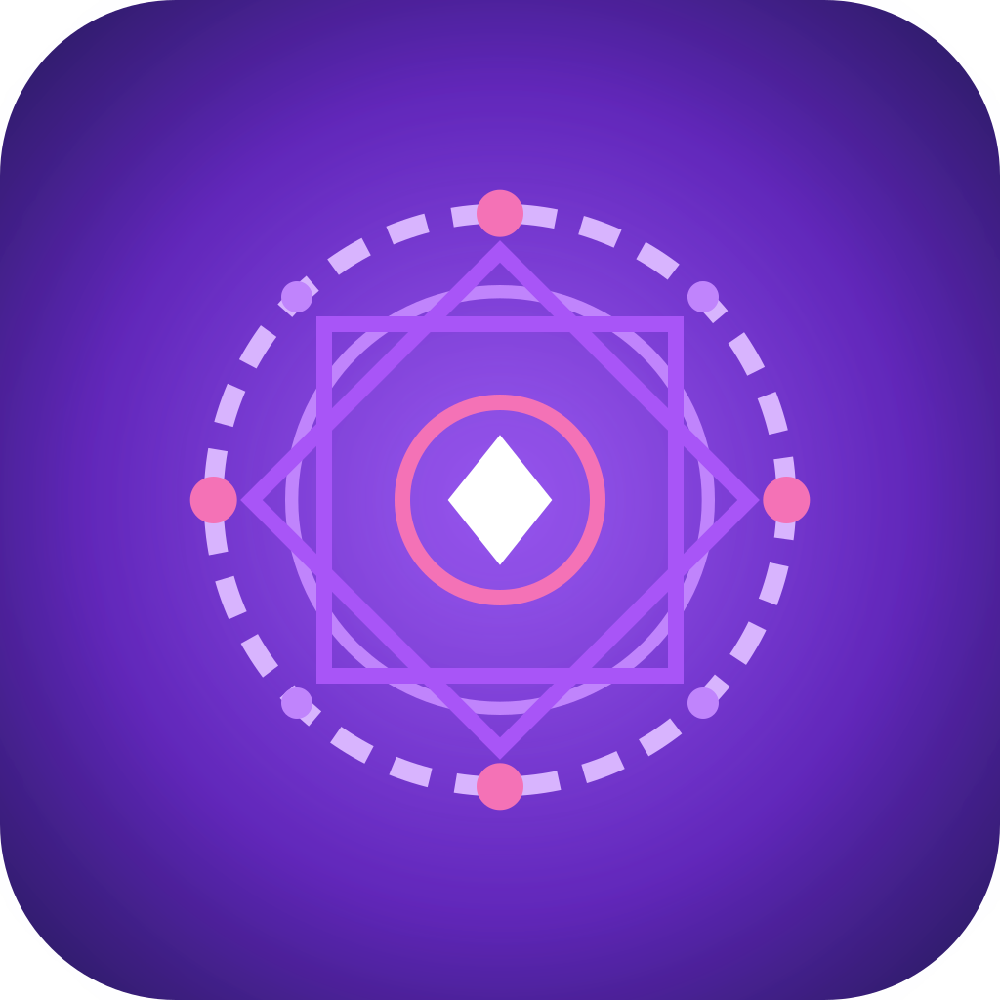

<p align="center">
  
</p>

<h1 align="center">Omnitome</h1>

<p align="center">
  <strong>A local-first neural reading library with loss-bounded, provenance-aware semantic compression.</strong>
</p>

<p align="center">
  <a href="./LICENSE"></a>
  
  
  
  
  
  
</p>

---

## 💡 The Pitch: Compression, Not Summarization

Conventional reading tools summarize by discarding nuances. Omnitome works differently: it performs **loss-bounded semantic compression** (~7:1 ratio) to preserve technical depth, logical structure, and essential arguments.

At the heart of Omnitome is the **Two-Representation Invariant**:
- 📄 **Original Reading (Research View):** The immutable, verbatim ground truth. Uploaded documents (PDF, EPUB, DOCX, Web) are preserved forever without alteration.
- 🧠 **Omni Reading (Library View):** An adaptively synthesized reading lens. Every sentence retains deterministic, clickable citations connecting directly back to the exact source paragraphs in Research.

```text
┌──────────────────────────────────────────────┐
│       ORIGINAL READING (Research View)       │  ←  Immutable source, verbatim, never modified
│          [Raw PDF / EPUB / TXT / Web]        │
└──────────────────────┬───────────────────────┘
                       │  Loss-bounded neural compression (~7:1)
                       │  Deterministic paragraph-level vector attribution
                       ▼
┌──────────────────────────────────────────────┐
│        OMNI READING (Library View)           │  ←  Derived reading lens, adaptively synthesized
│  [250–360 words/chapter + Clickable Citations]│
└──────────────────────────────────────────────┘
```

---

## ✨ Core Features

- 📌 **Loss-Bounded Provenance & Grounding:** Interactive sentence-level citations link every compressed claim to its exact source paragraph in the original text.
- 🔒 **100% Local-First & Private:** Run entirely offline with local LLMs (Ollama) and local embeddings. Zero cloud tracking, zero data egress.
- ⚡ **Hardware-Accelerated Vectorization:** PyTorch FP16 CUDA sidecar provides sub-second 16-chunk batch embeddings and input-calibrated cross-encoder reranking.
- 📚 **Universal Multi-Format Ingestion:** First-class ingestion for PDF (layout-aware & scanned OCR), EPUB, DOCX, RTF, Markdown, web URLs, and plain text with Tier 1+2 statistical charset detection.
- 🎙️ **Local Neural Voice (Kokoro-82M):** High-fidelity offline voice narration with gapless dual-deck playback, real-time sentence highlighting, and podcast auto-advance mode.
- 🎨 **Adaptive Theme & Typography Engine:** 5 bespoke visual themes (Omni, Sakura, Spring, Coffee, Cyberpunk), procedural SVG cover generation, and native KaTeX math typesetting.

👉 *Read the full breakdown in [docs/FEATURES.md](./docs/FEATURES.md).*

---

## 🏗️ System Overview

Omnitome is engineered as a coordinated multi-process desktop application:

```text
┌─────────────────────────────────────────────────────────────┐
│                 Tauri v2 Desktop Shell (Rust)               │
│             Window Lifecycle & Child-Process Supervisor     │
└──────────────┬───────────────────────────────┬──────────────┘
               ▼                               ▼
┌──────────────────────────────┐ ┌─────────────────────────────┐
│ Node.js 22 LTS Orchestrator  │ │ FastAPI Python Sidecar      │
│ • Sole SQLite WAL writer     │ │ • BGE-M3 (FP16 CUDA)        │
│ • Sequential Await Barrier   │ │ • BGE Reranker v2           │
│ • Import Queue Daemon        │ │ • Kokoro-82M Neural TTS     │
│ • Peak RAM: 296 MB           │ │ • Idle VRAM Eviction (3.2GB)│
└──────────────────────────────┘ └─────────────────────────────┘
```

- **Tauri v2 (Rust):** Provides the native desktop container, handles system close events, and supervises background processes.
- **Node.js 22 LTS (Express 5):** Sole writer to SQLite (`better-sqlite3` in WAL mode). Manages pipeline backpressure via an await barrier (dropping peak RAM from 14.6 GB to 296 MB).
- **Python Sidecar (`127.0.0.1:8765`):** Offloads GPU-heavy tasks. An automated lifecycle daemon evicts idle models, freeing **3.2 GB of VRAM** back to your system.

👉 *Read the complete architectural specification in [docs/ARCHITECTURE.md](./docs/ARCHITECTURE.md).*

---

## ⚡ Performance Highlights

| Benchmark Metric | Empirical Measurement | Architectural Note |
| :--- | :--- | :--- |
| **508K-Word Book Ingestion** | **~5.9 minutes** | 30x+ faster than unbatched baselines |
| **Node.js Peak Memory** | **296 MB** | 98% reduction via F65 await barrier |
| **16-Chunk Embedding Batch** | **< 1 second** | PyTorch FP16 CUDA acceleration |
| **Idle GPU VRAM Usage** | **174 MB** | 3.2 GB returned to OS via F43 daemon |
| **Corpus Gate Verification** | **10 / 10 Passing** | 3-class assertion engine (Classes A, B, C) |

👉 *Review the complete empirical benchmark suite in [docs/BENCHMARKS.md](./docs/BENCHMARKS.md).*

---

## 🗺️ Roadmap & Milestones

| Milestone | Status | Description |
| :--- | :--- | :--- |
| **Phase 5.8** | ✅ Complete | Pre-packaging UX, themes, core engine |
| **Phase 5.9** | ✅ Complete | Local Kokoro TTS (Sentence highlighting, auto-advance) |
| **S11 — Tauri Scaffold** | ✅ Complete | Native desktop shell, app icon |
| **S12 — Supervisor** | ✅ Complete | PyInstaller freeze, dynamic ports, process tree cleanup |
| **S13 — Resources** | ✅ Complete | Neural setup UX, streaming downloads, hash locking |
| **S14 — Installer** | 🚧 In Progress | NSIS dual-installer pipeline |
| **S15 — Release** | 📋 Planned | Code signing, distribution |

👉 *Track strategic milestones and deep architectural context in [docs/ROADMAP_2026-09.md](./docs/ROADMAP_2026-09.md).*

---

## 🚀 Quick Start

### Prerequisites
- **Node.js 22 LTS** (see `.nvmrc`)
- **Python 3.10+** (with NVIDIA GPU recommended for FP16 CUDA acceleration)
- **Local LLM Engine** ([Ollama](https://ollama.ai/) at `http://localhost:11434/v1`) or OpenRouter API key

### Installation & Setup

```bash
# 1. Clone repository & install Node dependencies
git clone https://github.com/avengersvstheflash/Smart-Reader.git
cd Smart-Reader
npm install
cp .env.example .env

# 2. Set up Python sidecar environment
cd sidecars/python
python -m venv .venv
# Windows:
.venv\Scripts\activate
# Linux/macOS:
# source .venv/bin/activate
pip install -r requirements.txt
cd ../..

# 3. Install frontend dependencies
npm --prefix frontend install
```

### Running the Application

```bash
# Run full development stack (Sidecar + Node Orchestrator + Vite Frontend):
npm run dev

# Or run tests and corpus gates:
npm test
node scripts/run-corpus-tests.js
```

---

## 📚 Documentation Hub

| Document | Purpose & Key Topics |
| :--- | :--- |
| 🏗️ **[Architecture Guide](./docs/ARCHITECTURE.md)** | Multi-process topology, F52 state coordination, SQLite schema v3, and pipeline reliability |
| ⚡ **[Empirical Benchmarks](./docs/BENCHMARKS.md)** | Real-world throughput tables, memory footprints, and chronological development velocity |
| 📖 **[Feature Catalog](./docs/FEATURES.md)** | Multi-format ingestion, Kokoro neural voice, theme engine, and two-representation invariant |
| 🗺️ **[Strategic Roadmap](./docs/ROADMAP_2026-09.md)** | Historical milestones, current Phase 6.0 desktop packaging, and release roadmap |
| ⚖️ **[Rights & Licensing](./docs/RIGHTS.md)** | AGPL-3.0 licensing framework, copyright boundaries, and dual-licensing provisions |
| 🤝 **[Session Handoff](./docs/SESSION_HANDOFF.md)** | Fast contributor orientation, active system invariants, and operational runbook |

---

## 📄 License

Omnitome is open-source software licensed under the [AGPL-3.0-only License](./LICENSE).

Versions of this repository tagged before 2026-10-18 were released under the MIT License. The v1.0 codebase and all subsequent versions are licensed under AGPL-3.0-only.
