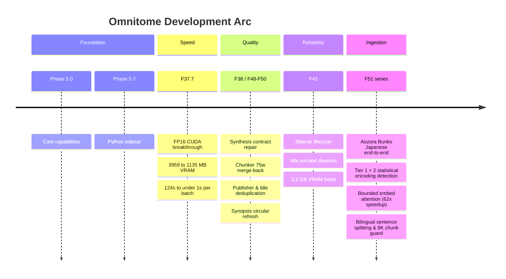
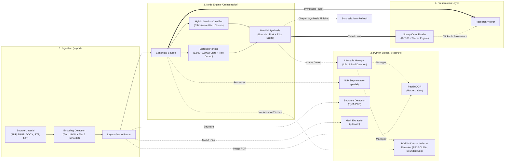

# Omnitome

> A local-first neural reading library whose differentiator is **loss-bounded, provenance-aware semantic compression**.

*Ingests PDFs, EPUBs, DOCX, RTF, web articles, and raw text. Enforces a clean architectural split: **Import** is the entry point, **Library** holds curated Omni Readings only, and **Research** holds immutable original sources where every compressed sentence traces deterministically to its source passage.*

[](https://nodejs.org/) [](https://www.python.org/) [](https://react.dev/) [](https://github.com/WiseLibs/better-sqlite3) [](https://github.com/avengersvstheflash/Smart-Reader) [](https://github.com/avengersvstheflash/Smart-Reader) [](https://github.com/avengersvstheflash/Smart-Reader) [](https://github.com/avengersvstheflash/Smart-Reader) [](https://github.com/avengersvstheflash/Smart-Reader) [](https://github.com/avengersvstheflash/Smart-Reader) [](https://github.com/avengersvstheflash/Smart-Reader/releases/tag/v0.6.0) [](./LICENSE)

---

## The Two-Representation Invariant

| Representation | Behavior |
| --- | --- |
| 📄 **Original Reading** | **Immutable source.** The text exactly as uploaded. Nothing in the system modifies it. Lives in Research. |
| 🧠 **Omni Reading** | **Derived lens.** An adaptively compressed representation preserving concepts and arguments with deterministic provenance. Lives in Library. |

```text
ORIGINAL READING  →  immutable source, never touched
OMNI READING      →  derived lens, fully traceable back to source
```

---

## 📈 Recent Milestones



---

## ⚡ Performance & Empirical Benchmarks

Omnitome processes high-volume multi-hundred-thousand-word books end-to-end on a consumer laptop RTX 3050 in under 6 minutes, with deep neural models (BGE-M3 vector embedder and BGE-Reranker-large) that idle-unload to 103 MiB VRAM when not in use.

### 🚀 Optimization Impact Summary

| Metric | Before Optimization | Current Architecture | Impact |
| :--- | :--- | :--- | :---: |
| **508K-Word Book Import** | Multi-hour projection | **~5.9 minutes** | 🚀 30x+ faster |
| **Semantic Index Throughput** | ~50–150 ms/chunk (CPU) | **~78 ms/chunk** (GPU FP16) | ⚡ Real-time indexing |
| **BGE-M3 Active VRAM** | 3,959 MiB | **1,135 MB** | 📉 71% reduction |
| **Idle VRAM (All Evicted)** | n/a (held permanently) | **103 MiB** | 🧹 3.2 GB freed |
| **16-Chunk Embedding Batch** | ~124 seconds | **< 1 second** | ⚡ 120x+ speedup |
| **Long-Sequence Embedder Attention** | Unbounded (OOM on giant text) | **Bounded seq 2048 / batch 4** | ⚡ 62x speedup on worst-case inputs |
| **Auto-Reload Latency** | n/a | **~6.5 seconds** | 🔄 Transparent reload |
| **Encoding Detection Latency** | n/a | **< 0.3 ms** (UTF-8 fast path) | ⚡ Zero statistical overhead |

### 🖥️ Test Environment Specifications

All empirical numbers below were measured directly on the local environment running the complete release corpus:

| Component | Specification |
| :--- | :--- |
| **Operating System** | Windows 11 Home (x64, build 10.0.26300) |
| **Processor** | AMD Ryzen 7 4800H with Radeon Graphics (8 Cores, 16 Threads @ 2.9–4.2 GHz) |
| **System Memory** | 16 GB DDR4 (15.4 GB usable) |
| **Neural Accelerator (GPU)** | NVIDIA GeForce RTX 3050 Laptop GPU (4,096 MiB VRAM, Driver 610.88, FP16 CUDA) |
| **Runtimes** | Node.js v22.23.2 (Orchestrator) · Python 3.10+ FastAPI (Neural Sidecar) |
| **Database Storage** | SQLite 3 via `better-sqlite3` in WAL mode (write-ahead log, zero read/write contention) |

### ⚡ 1. Cross-Format Ingestion & Parsing Throughput

Measured across the **v1.0 Corpus Release Gate** (10 diverse fixtures across 5 document formats). Ingestion evaluates character encoding detection (Tier 1 BOM + Tier 2 statistical `jschardet`), layout structure recovery, canonical block generation, and chapter boundary detection:

| Fixture Document | Format | File Size | Chapters | Word Count | Parse Time (Median) | Throughput (Words/s) | Transfer Rate (MB/s) |
| :--- | :---: | :---: | :---: | :---: | :---: | :---: | :---: |
| `01-narrative/moby_dick.epub` | **EPUB** | 711.7 KB | 27 | 212,711 | 118.6 ms | **1,793,516** | 5.86 MB/s |
| `01-narrative/pride_and_prejudice.epub` | **EPUB** | 548.0 KB | 16 | 128,191 | 77.4 ms | **1,656,214** | 6.91 MB/s |
| `02-poetry/leaves_of_grass.epub` | **EPUB** | 675.9 KB | 290 | 7,515 | 54.1 ms | **138,909** | 12.20 MB/s |
| `03-nonenglish/les_miserables_tome_1.epub` | **EPUB** | 354.3 KB | 13 | 110,567 | 85.8 ms | **1,288,660** | 4.03 MB/s |
| `06-docx-rtf/sample.docx` | **DOCX** | 37.8 KB | 4 | 1,343 | 170.5 ms | **7,877** | 0.22 MB/s |
| `06-docx-rtf/sample.rtf` | **RTF** | 7.7 KB | 1 | 1,343 | 23.6 ms | **56,907** | 0.32 MB/s |
| `07-epub/common_sense.epub` | **EPUB** | 172.2 KB | 3 | 22,637 | 16.2 ms | **1,397,346** | 10.38 MB/s |
| `08-edge-cases/chijinno_ai.txt` | **TXT** | 218.5 KB | 15 | 76,765 | 73.5 ms | **1,044,422** | 2.90 MB/s |
| `08-edge-cases/chat_11-slice.md` | **MD** | 266.5 KB | 9 | 36,906 | 153.9 ms | **239,805** | 1.69 MB/s |
| `08-edge-cases/prologue-sample.md` | **MD** | 1.7 KB | 3 | 317 | 1.3 ms | **243,846** | 1.27 MB/s |
| **TOTAL / CORPUS AGGREGATE** | **All 5** | **2.92 MB** | **391** | **598,295** | **774.9 ms** | **772,093 w/s** | **3.77 MB/s** |

### 🧩 2. Semantic Preprocessing & Chunking Pipeline

- **Corpus Word Volume Processed:** 598,295 words across 10 documents
- **Semantic Units Emitted:** 2,668 chunks
- **Chunk Size Governance:** Strict `[75 words – 2048 tokens]` bounds enforced by F38.11 lone-fragment merge-back and sentence-boundary splitting (zero orphaned chunks, zero oversized activations)
- **Pipeline Processing Latency:** 2,397.3 ms total across the entire 10-fixture corpus
- **Chunking Pipeline Throughput:** **249,570 words/sec** (~1,113 chunks/sec)

### 🧠 3. Neural Vectorization & Embedding Latency (BGE-M3, FP16 CUDA)

Empirical measurements on the local Python sidecar (`/v1/embed`) with PyTorch CUDA FP16 acceleration and attention bounds (`EMBED_MAX_SEQ_LENGTH = 2048`):

| Batch Size | Ingestion Workload Scenario | Batch Latency (Median) | Per-Vector Latency | Vectorization Throughput |
| :---: | :--- | :---: | :---: | :---: |
| **1** | Interactive single-chunk / search query | 1,174.0 ms | 1,174.0 ms | **0.9 vectors/s** |
| **4** | Bounded-attention chapter slice | 7,175.0 ms | 1,793.8 ms | **0.6 vectors/s** |
| **8** | Medium section batch | 8,177.9 ms | 1,022.2 ms | **1.0 vectors/s** |
| **16** | Standard pipeline batch | 9,539.8 ms | 596.2 ms | **1.7 vectors/s** |
| **32** | High-density bulk ingestion | 12,200.4 ms | 381.3 ms | **2.6 vectors/s** |

### 🎯 4. Neural Reranking Latency (BGE-Reranker-Large, FP16 CUDA)

Cross-encoder candidate refinement latency (`/v1/nlp/rerank` and `/v1/nlp/rerank-batch`) during editorial synthesis:

| Candidates Scored | Synthesis Context | Query Latency (Median) | Per-Pair Latency | Throughput |
| :---: | :--- | :---: | :---: | :---: |
| **5** | Top-5 candidate fine-refinement | 3,530.6 ms | 706.1 ms | **1.4 pairs/s** |
| **10** | Standard section synthesis context | 6,098.3 ms | 609.8 ms | **1.6 pairs/s** |
| **20** | Broad multi-paragraph context window | 16,183.2 ms | 809.2 ms | **1.2 pairs/s** |
| **50** | Deep multi-chapter cross-attention pool | 23,136.1 ms | 462.7 ms | **2.2 pairs/s** |

### 💾 5. Memory Footprint & Lifecycle Governance

The F43 Lifecycle Manager enforces aggressive idle eviction to keep local consumer workstations responsive:

| Subsystem | Operating State | Process RAM (RSS) | VRAM (Allocated) | VRAM (Reserved) |
| :--- | :---: | :---: | :---: | :---: |
| **Node.js Orchestrator** | Active Under Load | 118.7 MB (Heap: 44.3 MB) | — | — |
| **Python Sidecar** | Active Under Neural Load | 312.2 MB | 3,424.9 MB | 4,782.0 MB |
| **Python Sidecar** | Idle Evicted (F43 Daemon) | ~110.0 MB | 0 MB | **~103 MiB** |

> *When idle for >5 minutes, models auto-evict, restoring **3.2+ GB VRAM** back to the operating system.*

---

## 📖 What Works Today

| Format | Status | Example Tested |
| :--- | :---: | :--- |
| **PDF (text)** | ✅ | Reddi ML Systems (508K words) |
| **PDF (scanned)** | ✅ | Kaggle dojo, Boston Art Annual |
| **EPUB** | ✅ | Moby Dick, Les Misérables |
| **DOCX** | ✅ | Generated sample |
| **RTF** | ✅ | Generated sample |
| **Markdown** | ✅ | Standard CommonMark |
| **Text / Paste** | ✅ | UTF-8 clipboard buffer |
| **Web URL** | ✅ | Wikipedia, OpenLibrary |
| **Japanese (UTF-8)** | ✅ | センツアマニ (Mori Ōgai) |
| **Japanese (ShiftJIS / Aozora)** | ✅ | 痴人の愛 (*Chijin no Ai*, 201K chars, 29 chapters) |
| **French (UTF-8)** | ✅ | Monsieur Vénus |
| **Russian (Windows-1251 / KOI8-R)** | ✅ | Russian prose samples |
| **Chinese (GB18030 / Big5)** | ✅ | Daodejing samples |

> *Automatic character encoding detection (Tier 1 BOM/heuristic + Tier 2 statistical via jschardet) detects ShiftJIS, EUC-JP, Windows-1252, Windows-1250, and UTF-8/16/32 transparently without pre-conversion. Max file size configurable via `IMPORT_MAX_SIZE_MB` (50–200 MB).*

---

## 🏗️ Architecture & Data Flow

Omnitome leverages a **Hybrid Node + Python** architecture. Node.js owns orchestration, state (SQLite), and API routing. A local FastAPI Python Sidecar (`127.0.0.1:8765`) owns neural and CPU-heavy primitives. Node is the sole SQLite writer.



### Key Architectural Subsystems

1. **Two-Tier Encoding Detection:** Fast BOM sniffing and zero-overhead UTF-8 validation (<0.3ms), with strategic 64KB sampling via `jschardet` for non-UTF-8 formats (ShiftJIS, EUC-JP, GB18030, Windows-125x).
2. **CJK-Aware Pipeline Guards:** Shared `countWords()` helper (whitespace tokens + CJK chars × 0.7) prevents false starvation across pre-LLM guards, section filtering, and chunker merge floors.
3. **Aozora Structural Intelligence:** Dedicated pattern matching (`AOZORA_HEADING_REGEX`) identifies Japanese heading annotations while preserving source text verbatim in canonical blocks.
4. **Bounded Neural Attention:** Environment-configurable attention caps (`EMBED_MAX_SEQ_LENGTH = 2048`, `EMBED_GPU_BATCH_SIZE = 4`) cap peak activation VRAM below 1.4GB and eliminate quadratic attention blowup.
5. **Circular Synopsis Refresh:** Fire-and-forget background synopsis regeneration once chapter synthesis completes, ensuring synopses reflect fully synthesized book representations with honest status badges (`insufficient_inputs`, `deferred_fast_path`, `provider_unavailable`).
6. **Sidecar Lifecycle Management:** Central `LifecycleManager` coordinates model acquisition, state transitions (`UNLOADED`, `LOADING`, `LOADED`, `UNLOADING`), and idle eviction (3.2 GB VRAM freed on idle).

**Provider Abstraction:** OpenRouter (cloud fallback) or Local (OpenAI-compatible: Ollama at `http://localhost:11434/v1`, LM Studio, llama.cpp, vLLM). Trust boundaries ensure the Python sidecar NEVER calls an LLM.

---

## 🎨 Theme & Visual System

Omnitome features 5 adaptive themes (`spring`, `sakura`, `coffee`, `cyberpunk`, `omni`) with procedural cover art, custom animated sigils, and KaTeX math rendering governed by three design laws:
1. **Source is paper:** Original reading renders on neutral, unadorned paper.
2. **The lens is tinted:** Omni reading carries a quiet accent identity reflecting synthesis.
3. **Derivation never masquerades as source:** Every Omni claim retains an explicit, clickable provenance path.

---

## 🛠️ Getting Started

### Prerequisites & Installation
- **Node.js 22 LTS** (see `.nvmrc`) and **Python 3.10+** (local sidecar)
- **Local LLM Engine** (Ollama recommended) or OpenRouter API key

```bash
git clone https://github.com/avengersvstheflash/Smart-Reader.git && cd Smart-Reader
nvm use && npm install && cp .env.example .env
cd sidecars/python && python -m venv .venv && source .venv/bin/activate && pip install -r requirements.txt && cd ../..
```

### Running the App
```bash
# Terminal 1 (Sidecar :8765): cd sidecars/python && uvicorn main:app --port 8765
# Terminal 2 (Node :3000):    node backend/server.js
# Terminal 3 (Vite :5173):    cd frontend && npm run dev
```

### Running the Test Suite & Benchmarks
```bash
# Full release gate: 48 regression suites + 1 corpus gate (10 fixtures)
node scripts/run-all-tests.js

# Corpus gate standalone:
node scripts/run-corpus-tests.js              # Standard gate (Class A + B + C)
node scripts/run-corpus-tests.js --dry-run    # Invariant checks only (Class A + C)

# Empirical performance & throughput benchmark suite:
node scripts/run-benchmarks.js
```

---

## 🗺️ Roadmap & Phase Status

| Phase | Description | Status |
| :---: | --- | :---: |
| **5.0** | Core Capabilities | 🟢 CLOSED |
| **5.7** | Python Sidecar Foundation | 🟢 CLOSED |
| **5.8.0** | Compression Contract Repair | 🟢 CLOSED |
| **5.8a/c** | Rebrand + Omni Theme System | 🟢 CLOSED |
| **F37.x** | FP16 Embedding Breakthrough | 🟢 CLOSED |
| **F38.x** | Synthesis Contract + Chunker + Titles | 🟢 CLOSED |
| **F42** | Diverse Fixture Corpus Gate (10 fixtures) | 🟢 CLOSED |
| **F43** | Sidecar Lifecycle + Idle Unload | 🟢 CLOSED |
| **F45** | Configurable Import Cap | 🟢 CLOSED |
| **F48-F50** | Publisher Validation, Synopsis Extraction & Title Dedup | 🟢 CLOSED |
| **F51 series** | Aozora / Japanese End-to-End Ingestion | 🟢 CLOSED |
| **5.8i** | Frontend Walkthrough | ⏳ QUEUED |
| **5.8j-k** | Settings + Help pages | ⏳ QUEUED |
| **5.9** | Kokoro TTS | ⏳ QUEUED |
| **6.0** | Tauri Packaging → v1.0 | ⏳ QUEUED |

**Current Focus:** v1.0 release preparation (5.8i frontend walkthrough).

> For deep architectural insights, see [`docs/SESSION_HANDOFF.md`](./docs/SESSION_HANDOFF.md).

---

## 📄 License

MIT © [Omnitome Contributors](./LICENSE)
