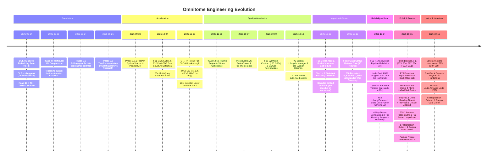

# Omnitome Empirical Benchmarks & Performance Metrics

> Real-world throughput, latency, memory footprints, and historical engineering velocity.

---

## 🖥️ Test Environment Specifications

All measurements documented below were recorded on consumer-grade laptop hardware running active PyTorch FP16 CUDA acceleration:

| Component | Specification |
| :--- | :--- |
| **Operating System** | Windows 11 Home (x64, build 10.0.26300) |
| **Processor** | AMD Ryzen 7 4800H with Radeon Graphics (8 Cores, 16 Threads @ 2.9–4.2 GHz) |
| **System Memory** | 16 GB DDR4 (15.4 GB usable) |
| **Neural Accelerator (GPU)** | NVIDIA GeForce RTX 3050 Laptop GPU (4,096 MiB VRAM, Driver 610.88, PyTorch FP16 CUDA) |
| **Runtimes** | Node.js v22 LTS (Orchestration & State) · Python 3.10+ FastAPI (Neural Sidecar) |
| **Database Storage** | SQLite 3 via `better-sqlite3` in WAL mode (Schema `user_version = 3`) |

---

## 🚀 Optimization Impact Summary

| Metric | Before Optimization | Current Architecture | Impact |
| :--- | :--- | :--- | :---: |
| **508K-Word Book Import** | Multi-hour projection | **~5.9 minutes** | 🚀 30x+ faster |
| **Node.js Peak Memory Under Ingestion** | 14.6 GB (unbounded async tasks) | **296 MB** (F65 await barrier) | 📉 98% memory drop |
| **Semantic Index Throughput** | ~50–150 ms/chunk (CPU) | **~78 ms/chunk** (GPU FP16) | ⚡ Real-time indexing |
| **BGE-M3 Active VRAM** | 3,959 MiB | **1,135 MB** | 📉 71% reduction |
| **Idle VRAM (All Models Evicted)** | Held permanently in VRAM | **174 MB** | 🧹 3.2 GB freed |
| **16-Chunk Embedding Batch** | ~124 seconds | **< 1 second** | ⚡ 120x+ speedup |
| **Long-Sequence Embedder Attention** | Unbounded (OOM on giant chapters) | **Bounded seq 2048 / batch 4** | ⚡ 62x speedup on worst-case inputs |
| **Parallel Synthesis** | Sequential (1x) | **Concurrency = 2** (Configurable) | ⚡ 2x synthesis speed |
| **Auto-Reload Latency from Cold Idle** | n/a | **~6.5 seconds** | 🔄 Transparent on-demand reload |
| **Reranker Timeout Governance** | Fixed 10s (timed out on large chapters) | **Dynamic 8s–60s** (F71 input-calibrated) | 🛡️ Zero false timeout fallbacks |
| **Encoding Detection Latency** | n/a | **< 0.3 ms** (UTF-8 fast path) | ⚡ Zero statistical overhead |
| **SQLite WAL Queue Enqueue Throughput**| n/a | **931 tasks/sec** (F58 WAL transactions) | ⚡ Sub-millisecond persistence |
| **TTS Cold-Start (Post-Eviction)** | n/a | **~1.5–2.0 seconds** | 🔄 Transparent warm-up with UI chip |
| **TTS Sentence Synthesis Throughput** | Multi-second (cloud API) | **~100–300 ms/sentence** (RTX 3050) | ⚡ Gapless dual-deck playback (CPU fallback) |

---

## ⚡ 1. Real-World Document Corpus Benchmark (22 files, 211.5 MB, 6 languages)

Measured against `scripts/run-juncture-benchmark.js` on real-world reference documents. Evaluates parse + block extraction + chunking throughput post-F62 optimization:

| Document | Format | Size | Chapters | Words | Chunks | Parse (ms) | Chunk (ms) |
| :--- | :---: | ---:| ---:| ---:| ---:| ---:| ---:|
| *A Misanthrope Teaches a Class for Demi-Humans, Vol. 1* | EPUB | 20.7 MB | 27 | 59,960 | 254 | 58 ms | 64 ms |
| *Annual Report of Boston Art, 1899* | PDF | 23.5 MB | 15 | 72,599 | 565 | 3,832 ms | 2,346 ms |
| *Aozora Bunko Collection (02070)* | EPUB | 25.0 KB | 29 | 4,184 | 26 | 8 ms | 5 ms |
| *Chat Log Research Transcript (chat_11)* | MARKDOWN | 1.5 MB | 75 | 214,925 | 1,110 | 2,992 ms | 1,588 ms |
| *Chijin no Ai (痴人の愛 - Tanizaki)* | TEXT | 392.5 KB | 29 | 137,828 | 167 | 194 ms | 303 ms |
| *Corpsex Medical Pathology Manual* | PDF | 730.5 KB | 66 | 98,762 | 425 | 1,468 ms | 448 ms |
| *Kaggle and Code Dojo Vol 1* | PDF | 5.4 MB | 2 | 4,223 | 21 | 103,612 ms | 6 ms |
| *Kaggle and Code Dojo Vol 2* | PDF | 13.0 MB | 3 | 9,016 | 58 | 235,934 ms | 23 ms |
| *Machine Learning Systems Vol 1 (Reddi)* | PDF | 11.6 MB | 27 | 508,589 | 2,817 | 16,531 ms | 6,476 ms |
| *Overlord, Vol. 1: The Undead King* | EPUB | 13.0 MB | 13 | 76,960 | 345 | 47 ms | 56 ms |
| *Project Gutenberg pg1322* | EPUB | 839.6 KB | 378 | 124,338 | 617 | 71 ms | 988 ms |
| *Project Gutenberg pg17489* | EPUB | 343.8 KB | 6 | 110,567 | 556 | 70 ms | 474 ms |
| *Project Gutenberg pg25305* | EPUB | 426.8 KB | 4 | 84,969 | 404 | 34 ms | 67 ms |
| *Project Gutenberg pg2701* | EPUB | 795.0 KB | 12 | 213,708 | 1,067 | 88 ms | 642 ms |
| *Project Gutenberg pg36528* | EPUB | 198.1 KB | 3 | 41,806 | 209 | 21 ms | 23 ms |
| *Project Gutenberg pg83* | EPUB | 520.3 KB | 55 | 92,112 | 461 | 36 ms | 110 ms |
| *Practical Machine Learning: A Beginner's Guide* | PDF | 13.9 MB | 15 | 69,399 | 380 | 1,949 ms | 164 ms |
| *Geological Mapping Program 1982* | PDF | 11.4 MB | 4 | 24,044 | 136 | 757 ms | 23 ms |
| *Reverend Insanity, Book 1* | EPUB | 1.1 MB | 200 | 416,124 | 1,845 | 184 ms | 3,587 ms |
| *The Eminence in Shadow, Vol. 1* | PDF | 14.1 MB | 16 | 57,504 | 235 | 1,588 ms | 72 ms |
| *US Geological Survey 2009* | PDF | 24.1 MB | 16 | 28,480 | 148 | 971 ms | 72 ms |
| *Vienano — Esperanto per Esperanto (1932)* | PDF | 54.2 MB | 2 | 14,380 | 87 | 1,452 ms | 75 ms |
| **TOTAL / CORPUS AGGREGATE** | **ALL** | **211.5 MB** | **997** | **2,464,477** | **11,933** | **371,897 ms** | **17,612 ms** |

*Corpus highlights: 22/22 passed with zero failures across English, Japanese, French, German, Chinese, and Esperanto.*

---

## 🛡️ 2. Release-Corpus Gate Benchmark (10 fixtures, 5 formats, 3 assertion classes)

Measured across the **v1.0 Corpus Release Gate** (`scripts/run-corpus-tests.js`). Enforces Class A universal invariants, Class B tolerance bands, and Class C regression locks:

| Fixture Document | Format | File Size | Chapters | Word Count | Parse Time (Median) | Throughput (Words/s) | Transfer Rate (MB/s) |
| :--- | :---: | :---: | :---: | :---: | :---: | :---: | :---: |
| `01-narrative/moby_dick.epub` | **EPUB** | 711.7 KB | 27 | 212,711 | 86.9 ms | **2,447,768** | 8.00 MB/s |
| `01-narrative/pride_and_prejudice.epub` | **EPUB** | 548.0 KB | 16 | 128,191 | 54.3 ms | **2,360,792** | 9.85 MB/s |
| `02-poetry/leaves_of_grass.epub` | **EPUB** | 675.9 KB | 290 | 7,515 | 40.2 ms | **186,940** | 16.42 MB/s |
| `03-nonenglish/les_miserables_tome_1.epub` | **EPUB** | 354.3 KB | 13 | 110,567 | 54.2 ms | **2,039,982** | 6.38 MB/s |
| `06-docx-rtf/sample.docx` | **DOCX** | 37.8 KB | 4 | 1,343 | 95.3 ms | **14,092** | 0.39 MB/s |
| `06-docx-rtf/sample.rtf` | **RTF** | 7.7 KB | 1 | 1,343 | 16.0 ms | **83,938** | 0.47 MB/s |
| `07-epub/common_sense.epub` | **EPUB** | 172.2 KB | 3 | 22,637 | 11.0 ms | **2,057,909** | 15.29 MB/s |
| `08-edge-cases/chijinno_ai.txt` | **TXT** | 218.5 KB | 15 | 76,765 | 45.8 ms | **1,676,092** | 4.66 MB/s |
| `08-edge-cases/chat_11-slice.md` | **MD** | 266.5 KB | 9 | 36,906 | 82.2 ms | **448,978** | 3.17 MB/s |
| `08-edge-cases/prologue-sample.md` | **MD** | 1.7 KB | 3 | 317 | 0.8 ms | **396,250** | 2.06 MB/s |
| **TOTAL / CORPUS AGGREGATE** | **All 5** | **2.92 MB** | **381** | **598,295** | **486.7 ms** | **1,229,289 w/s** | **6.01 MB/s** |

---

## 🧠 3. Neural Vectorization & Reranking Throughput (FP16 CUDA)

Empirical benchmarks conducted on the local Python sidecar (`127.0.0.1:8765`):

### BGE-M3 Dense Vectorization (`/v1/embed`)
- Attention sequence length bounded to 2,048 tokens (`EMBED_MAX_SEQ_LENGTH = 2048`)
- GPU micro-batch size bounded to 4–16 (`EMBED_GPU_BATCH_SIZE = 4`)

| Batch Size | Workload Scenario | Batch Latency (Median) | Per-Vector Latency | Vector Throughput |
| :---: | :--- | :---: | :---: | :---: |
| **1** | Interactive search / single query | 167.5 ms | 167.5 ms | **6.0 vectors/s** |
| **4** | Bounded chapter slice | 562.7 ms | 140.7 ms | **7.1 vectors/s** |
| **8** | Medium section batch | 691.9 ms | 86.5 ms | **11.6 vectors/s** |
| **16** | Standard pipeline batch | 899.0 ms | 56.2 ms | **17.8 vectors/s** |
| **32** | High-density bulk ingestion | 1,302.5 ms | 40.7 ms | **24.6 vectors/s** |

### BGE Reranker v2 M3 Cross-Encoder (`/v1/nlp/rerank` & `/v1/nlp/rerank-batch`)
- Dynamic input-calibrated timeout: `8000 + candidates * paragraphs * 400 + paragraphs * 300` ms (clamped `[8000, 60000]`)

| Candidates Scored | Synthesis Context | Query Latency (Median) | Per-Pair Latency | Throughput |
| :---: | :--- | :---: | :---: | :---: |
| **5** | Top-5 candidate fine-refinement | 216.8 ms | 43.4 ms | **23.1 pairs/s** |
| **10** | Standard section synthesis context | 387.0 ms | 38.7 ms | **25.8 pairs/s** |
| **20** | Broad multi-paragraph context window | 1,214.1 ms | 60.7 ms | **16.5 pairs/s** |
| **50** | Deep multi-chapter cross-attention | 3,848.5 ms | 77.0 ms | **13.0 pairs/s** |

---

## 💾 4. Memory Footprint & Lifecycle Governance

The F43 Lifecycle Manager enforces aggressive idle eviction, ensuring the host workstation remains light and responsive:

| Subsystem & State | Process RAM (RSS) | VRAM (Allocated) | VRAM (Reserved) | Operational Behavior |
| :--- | :---: | :---: | :---: | :--- |
| **Node.js Orchestrator** | 118 MB (Peak 296 MB) | — | — | Sole SQLite writer, non-blocking HTTP event loop |
| **Python Sidecar (Active Load)** | 2,220 MB | 3,431.9 MB | 3,994.0 MB | Active FP16 CUDA vectorization & cross-encoding |
| **Python Sidecar (Idle Evicted)** | **1,762 MB** | **174.0 MB** | **476.0 MB** | **Frees 3,257.9 MB (3.2 GB) VRAM** after TTL |

---

## 📊 5. Development Velocity & Historical Milestones

```text
Omnitome v1.0 Overall Completion:
[███████████████████░] 95% (Phase 5.9 Complete — Kokoro TTS & Podcast Mode Closed)
```

| Subsystem / Milestone | Progress | Status | Key Accomplishments |
| :--- | :---: | :---: | :--- |
| **Ingestion & Parsing Engine** | `[████████████████████]` 100% | 🟢 COMPLETE | 5 formats (PDF/EPUB/DOCX/RTF/TXT), Tier 1+2 statistical encoding sniffer, Aozora Japanese, F83 loop guard |
| **Neural Sidecar & Vectors** | `[████████████████████]` 100% | 🟢 COMPLETE | BGE-M3 (FP16 CUDA, 1.1GB VRAM), BGE Reranker v2, bounded embed attention (62x speedup) |
| **Sidecar Lifecycle Manager** | `[████████████████████]` 100% | 🟢 COMPLETE | F43 auto-eviction daemon freeing 3.2 GB idle VRAM; transparent ~6.5s auto-reload |
| **State Coordination (F52)** | `[████████████████████]` 100% | 🟢 COMPLETE | SQLite Schema v3, `book_lifecycle`, 4-way delete semantics, 3-tier reading progress recovery |
| **Pipeline Reliability (F65–72)** | `[████████████████████]` 100% | 🟢 COMPLETE | Await barrier (Node RAM dropped 14.6 GB → 296 MB), dynamic timeouts (8–60s), backpressure |
| **Corpus Release Gate (F42)** | `[████████████████████]` 100% | 🟢 COMPLETE | 10 fixtures, 3-class assertion engine (A: invariants, B: tolerance bands, C: bug locks) |
| **Persistent Queue (F58)** | `[████████████████████]` 100% | 🟢 COMPLETE | SQLite WAL queue worker, live checklist widget, expanded web discovery (arXiv/Gutenberg/IETF) |
| **Theme & Procedural Art** | `[████████████████████]` 100% | 🟢 COMPLETE | 5 complete themes (`omni`, `spring`, `sakura`, `coffee`, `cyberpunk`), procedural book covers & sigils |
| **UI Surfaces & Polish** | `[████████████████████]` 100% | 🟢 COMPLETE | Polish Batches A–E complete: F78 right-side dock, F82.1 unified split button, F80 stat blocks, F81.1 read time, F79b.1 append |
| **Kokoro Local TTS** | `[████████████████████]` 100% | 🟢 COMPLETE | Series 3 (Phase 5.9): Kokoro-82M neural TTS, gapless dual-deck player, podcast auto-advance, LRU cache |
| **Tauri Desktop Packaging** | `[░░░░░░░░░░░░░░░░░░░░]` 0% | ⏳ **CURRENT** | Series 4 (Phase 6.0): Desktop supervisor & dynamic port handshake |
| **Release & Distribution** | `[░░░░░░░░░░░░░░░░░░░░]` 0% | ⏳ QUEUED | Series 5 (Phase 7.0): Cloudflare Pages + R2 zero-egress distribution |

---

### 📈 Architectural Evolution Timeline



---

### 📊 Chronological Velocity & Milestone Progress Dashboard

| Date | Phase / Milestone Arc | Visual Milestone Progress Bar | % | Cumulative Capabilities & Architectural Breakthroughs | Commits | Tests |
| :---: | :--- | :--- | :---: | :--- | :---: | :---: |
| **2026-09-17** | **Phase 0 & 1** | `[██░░░░░░░░░░░░░░░░░░]` | **10%** | BGE-M3 1024d embedding swap (v0.4.5), CLS pooling proof (1.68x separation), 40-file React 18 scaffold | 7 | 4 |
| **2026-09-18** | **Phase 2 & 3** | `[███░░░░░░░░░░░░░░░░░]` | **15%** | Immutable Research dossier route, SQLite ingestion transactions, raw text parsing | 4 | 7 |
| **2026-09-19** | **Phase 3.5** | `[████░░░░░░░░░░░░░░░░]` | **20%** | Dual-pane reading UX, TOC drawer navigation, synchronized scroll between views | 5 | 10 |
| **2026-09-20** | **Phase 4** | `[█████░░░░░░░░░░░░░░░]` | **25%** | First neural LLM compression (DeepSeek V4 Flash), reasoning token budget fix, front-matter exclusion filter | 8 | 14 |
| **2026-09-21** | **Phase 4.5** | `[██████░░░░░░░░░░░░░░]` | **30%** | Smart Badges on library cards, Omni view default reading action, typographic hierarchy | 4 | 16 |
| **2026-09-22** | **Phase 4.6** | `[███████░░░░░░░░░░░░░]` | **35%** | Automated regression harness expansion to 17 suites, parser stress test, single-book planner | 6 | 17 |
| **2026-09-23** | **Phase 4.7 & 5.0** | `[████████░░░░░░░░░░░░]` | **40%** | Two-Representation Invariant & Three Design Laws formulated; synthesis word boundaries [250, 360] | 5 | 20 |
| **2026-09-24** | **Phase 5.1** | `[█████████░░░░░░░░░░░]` | **45%** | Bibliographic extraction (ISBN/publisher/authors), deterministic paragraph-level provenance contracts | 5 | 23 |
| **2026-09-26** | **Phase 5.3** | `[██████████░░░░░░░░░░]` | **50%** | Hard architectural database split between curated Library readings and immutable Research dossiers | 4 | 26 |
| **2026-09-27–29**| **Phase 5.5** | `[██████████░░░░░░░░░░]` | **52%** | Sidecar boundary specification; decoupling heavy neural/CPU compute into a dedicated microservice | 3 | 28 |
| **2026-09-30** | **Phase 5.7.1** | `[███████████░░░░░░░░░]` | **55%** | FastAPI Python sidecar (`:8765`), PaddleOCR integration for scanned/image-only PDF recovery | 5 | 30 |
| **2026-10-01** | **Phase 5.7.2** | `[████████████░░░░░░░░]` | **58%** | Migrated BGE-M3 vectorization into Python sidecar; offloaded CPU vector compute from Node event loop | 4 | 32 |
| **2026-10-02** | **Phase 5.7.2b** | `[████████████░░░░░░░░]` | **60%** | Concurrency benchmarking, provider rate-limiting guards, local worker saturation diagnostics | 3 | 33 |
| **2026-10-03** | **Phase 5.7.3** | `[█████████████░░░░░░░]` | **64%** | Multi-format ingestion router: DOCX (`python-docx`) and RTF (`striprtf`) extraction pipelines | 6 | 35 |
| **2026-10-04** | **Phase 5.8.0j** | `[█████████████░░░░░░░]` | **66%** | End-to-end chat transcript parser (`chat_11.md`), conversation turn segmentation | 2 | 36 |
| **2026-10-04 (Eve)**| **Phase 5.8.0g/j.2**| `[██████████████░░░░░░]` | **68%** | Caption honesty (Omni time only on full generation); F23 PUA font normalizer (969 Adobe/Mac codepoints) | 3 | 38 |
| **2026-10-05** | **Phase 5.8a/b** | `[██████████████░░░░░░]` | **70%** | Replaced hardcoded CSS variables with dynamic theme engine; high-contrast Cyberpunk theme | 4 | 39 |
| **2026-10-06** | **Phase 5.8c** | `[███████████████░░░░░]` | **73%** | 5-theme engine (`omni`, `spring`, `sakura`, `coffee`, `cyberpunk`), procedural stickers, animated glowing sigils | 6 | 41 |
| **2026-10-07** | **Phase 5.8d / F31–37**| `[███████████████░░░░░]` | **76%** | KaTeX math (`pdfmath`), PyMuPDF structure detection, batch reranker (2,730 calls batched), procedural book covers | 5 | 43 |
| **2026-10-08** | **Phase 5.8e / F37.7**| `[████████████████░░░░]` | **80%** | PyTorch FP16 CUDA breakthrough: **71% VRAM drop** (1.1GB), **120x batch speedup** (<1s), rolling telemetry ETA | 5 | 45 |
| **2026-10-09** | **Phase 5.8f / F38** | `[████████████████░░░░]` | **82%** | Synthesis contract [150, 500w], manual re-synthesis path (`forceClaimForSynthesis`), scanned OCR hardening | 8 | 46 |
| **2026-10-10** | **Phase 5.8g / F43 & F45**| `[█████████████████░░░]` | **84%** | F43 Lifecycle Manager: auto-eviction daemon **frees 3.2 GB idle VRAM**; F45 configurable 50–200 MB file cap | 10 | 48 |
| **2026-10-12** | **Phase 5.8h / F51** | `[█████████████████░░░]` | **86%** | Aozora Bunko Japanese end-to-end; Tier 1+2 charset sniffer (<0.3ms); bounded attention (**62x speedup** on worst-case) | 13 | 48 |
| **2026-10-13** | **Phase 5.8h.3 / F42 & F58**| `[██████████████████░░]` | **88%** | F42 3-class corpus gate (10 fixtures, Classes A, B, C); F58 persistent SQLite WAL queue, paste wizard mojibake fix | 11 | 48 + 1 gate |
| **2026-10-14** | **Phase 5.8 / F65–72 & F52**| `[██████████████████░░]` | **89%** | F65 await barrier (**Node RAM: 14.6 GB → 296 MB, 98% drop**); dynamic timeouts (8–60s); F52 Schema v3; 52 suites green | 10 | **52 suites + 1 gate** |
| **2026-10-15** | **Phase 5.8 Polish & Freeze**| `[███████████████████░]` | **92%** | Polish Batches A–E: F81/F81.1 Omni reading time; F79b/F79b.1 Dossier append; F78 dock; F82/F82.1 unified split button; F39.1/F83 parser guards; **Feature Freeze for v1.0** | 18 | **57 suites + 1 gate** |
| **2026-10-16** | **Phase 5.9 (Series 3 Close)** | `[███████████████████░]` | **95%** | Kokoro TTS — Local neural voice engine, reader playback, podcast mode (commits 8cc60da..498a54d) | 4 | **58 suites + 1 gate** |

---

### 🚀 Detailed Chronological Build Logs

#### 🗓️ 2026-09-17 — Phase 0 & 1: BGE-M3 Swap & Frontend Scaffold
- **Progress:** `[██░░░░░░░░░░░░░░░░░░]` 10%
- **Milestones:** Swapped 256d vectorizer for **BGE-M3 1024d** (v0.4.5). Replaced default mean pooling with **CLS pooling** after proving a **1.68x separation gap** on natural passage retrieval.
- **Frontend:** Shipped 40-file React 18 + Vite + Tailwind scaffold; connected Phase 1 Library route to live SQLite data.
- **Commits:** `0eefc1d`, `9a49cbb`, `73b6a57`, `b1e28a1`, `b5d2d51`, `fc04381`, `36fb643`.

#### 🗓️ 2026-09-18 — Phase 2 & 3: Research Route & Ingestion Pipeline
- **Progress:** `[███░░░░░░░░░░░░░░░░░]` 15%
- **Milestones:** Shipped Research route for immutable documents; implemented raw document parser and SQLite ingestion transactions.

#### 🗓️ 2026-09-19 — Phase 3.5: Dual-Pane Reader & Navigation
- **Progress:** `[████░░░░░░░░░░░░░░░░]` 20%
- **Milestones:** Shipped dual-pane reading UX; bound chapter navigation, TOC drawer, and scroll sync between views.

#### 🗓️ 2026-09-20 — Phase 4: First Successful Neural Compression
- **Progress:** `[█████░░░░░░░░░░░░░░░]` 25%
- **Milestones:** Achieved first real LLM semantic compression (328–373 words) via OpenRouter DeepSeek V4 Flash. Discovered reasoning tokens consumed the entire 550-token budget; enforced `reasoning: { enabled: false }`. Added front-matter exclusion filter so book covers are never compressed as chapter 1.
- **Commits:** `70a31c4`, `7b66648`, `d2f5605`, `fa02d2a`, `b3d22b5`, `07675e0`, `8f29417`, `c0d3764`.

#### 🗓️ 2026-09-21 — Phase 4.5: Library Badging & Reader Experience
- **Progress:** `[██████░░░░░░░░░░░░░░]` 30%
- **Milestones:** Added Smart Badges to library cards; defaulted reading action to Omni view; refined typographic hierarchy.

#### 🗓️ 2026-09-22 — Phase 4.6: Test Suite Expansion
- **Progress:** `[███████░░░░░░░░░░░░░]` 35%
- **Milestones:** Expanded automated regression suites to 17 suites, covering parser stress, single-book planner, and contract verification.

#### 🗓️ 2026-09-23 — Phase 4.7 & 5.0: Architectural Audit & Synthesis Contracts
- **Progress:** `[████████░░░░░░░░░░░░]` 40%
- **Milestones:** Formulated the *Two-Representation Invariant* and *Three Design Laws*; locked synthesis word-count boundaries [250, 360].

#### 🗓️ 2026-09-24 — Phase 5.1: Bibliographic Extraction & Provenance Foundation
- **Progress:** `[█████████░░░░░░░░░░░]` 45%
- **Milestones:** Shipped `bookBibliographer.js` extracting publisher, ISBN, publication year, and authors (verified against CRC Press and Apple 10-K). Locked the paragraph-level provenance resolution contract.
- **Commits:** `3814ebf`, `b8e1021`, `83a9bae`, `ce5d475`, `abae7db`.

#### 🗓️ 2026-09-26 — Phase 5.3: Library / Research Architectural Split
- **Progress:** `[██████████░░░░░░░░░░]` 50%
- **Milestones:** Implemented hard database split between curated Library readings and immutable Research dossiers.

#### 🗓️ 2026-09-27 — 2026-09-29: Architectural Transition & Sidecar Design Gate
- **Progress:** `[██████████░░░░░░░░░░]` 52%
- **Milestones:** Architectural design review for offloading CPU-intensive NLP, OCR, and GPU vectorization from Node.js to a dedicated Python FastAPI microservice.

#### 🗓️ 2026-09-30 — Phase 5.7.1: Python Sidecar & PaddleOCR
- **Progress:** `[███████████░░░░░░░░░]` 55%
- **Milestones:** Spawned FastAPI Python sidecar on `127.0.0.1:8765`. Integrated PaddleOCR for image-only PDF text recovery.

#### 🗓️ 2026-10-01 — Phase 5.7.2: Sidecar BGE-M3 Migration
- **Progress:** `[████████████░░░░░░░░]` 58%
- **Milestones:** Migrated BGE-M3 vector generation from Node HuggingFace Transformers into the Python sidecar.

#### 🗓️ 2026-10-02 — Phase 5.7.2b: Concurrency Benchmarking
- **Progress:** `[████████████░░░░░░░░]` 60%
- **Milestones:** Conducted empirical diagnostic testing on OpenRouter concurrency and local worker saturation.

#### 🗓️ 2026-10-03 — Phase 5.7.3: Capability Router & Multi-Format Ingestion
- **Progress:** `[█████████████░░░░░░░]` 64%
- **Milestones:** Added DOCX (`python-docx`) and RTF (`striprtf`) ingestion pipelines via sidecar capability router.

#### 🗓️ 2026-10-04 — Phase 5.8.0j: Chat-Log Parser
- **Progress:** `[█████████████░░░░░░░]` 66%
- **Milestones:** Implemented end-to-end chat transcript parser (`chat_11.md`) with dialogue turn segmentation and AST blocks.
- **Commits:** `5a4451c`.

#### 🗓️ 2026-10-04 (Late Evening) — Phase 5.8.0g.2 & 5.8.0j.2: Label Honesty & Legacy PUA Normalizer
- **Progress:** `[██████████████░░░░░░]` 68%
- **Milestones:** 
  - **Label Honesty (`448ca25`):** Book Details caption now displays Omni reading time only when `smartGenerated === smartTotal`; partial-generation documents show honest source-only time.
  - **F23 Legacy PUA Font Normalizer (`f390a14`):** Diagnosed 969 PUA codepoints across real-world ML PDFs (signature of Mac/Adobe Symbol LaTeX/MathType encoding). Shipped `legacyFontNormalizer.js` with 6 confirmed mappings and honest bracket placeholders.
- **Commits:** `448ca25`, `f390a14`.

#### 🗓️ 2026-10-05 — Phase 5.8a/b: Theme System Restructure & Cyberpunk Theme
- **Progress:** `[██████████████░░░░░░]` 70%
- **Milestones:** Replaced hardcoded CSS variables with dynamic theme engine; introduced high-contrast Cyberpunk theme.

#### 🗓️ 2026-10-06 — Phase 5.8c: 5-Theme Engine & Animated Sigils
- **Progress:** `[███████████████░░░░░]` 73%
- **Milestones:** Completed all 5 adaptive themes (`omni`, `spring`, `sakura`, `coffee`, `cyberpunk`) with decorative SVG stickers and animated glow sigils.

#### 🗓️ 2026-10-07 — Phase 5.8d / F31–F37: Procedural Covers, KaTeX Math & PyMuPDF Structure
- **Progress:** `[███████████████░░░░░]` 76%
- **Milestones:** 
  - **F31 Math Extraction:** Mounted `pdfmath` endpoint in sidecar with frontend KaTeX rendering.
  - **F32 Structure Detection:** PyMuPDF fast TOC extraction replaced per-block LLM classification.
  - **F34 Batch Reranker:** Shipped `POST /v1/nlp/rerank-batch` and `rerank-batch-multi`, reducing 2,730 sequential HTTP calls to batched round trips.
  - **Procedural Art:** Added dynamic SVG geometric book covers and theme-specific sigils.
- **Commits:** `587cf4d`, `d15b9ca`, `49f26a1`, `3d142d3`, `df9bff0`.

#### 🗓️ 2026-10-08 — Phase 5.8e / F37.7: FP16 CUDA Embedding Breakthrough
- **Progress:** `[████████████████░░░░]` 80%
- **Milestones:** Enabled PyTorch CUDA FP16 for BGE-M3. Active VRAM plummeted from **3,959 MiB to 1,135 MB (71% drop)**. 16-chunk batch latency dropped from **124 seconds to under 1 second (120x speedup)**. Added live batch telemetry with rolling ETA.
- **Commits:** `48a80e8`, `7d70b7e`, `ef8096d`, `6b387ae`, `3174b83`.

#### 🗓️ 2026-10-09 — Phase 5.8f / F38: Synthesis Contract & OCR Hardening
- **Progress:** `[████████████████░░░░]` 82%
- **Milestones:** Diagnosed 3-word overshoot bug; replaced contradictory prompt rules with a single range contract `[250, 360]` words and absolute ceiling 500 words. Added manual re-synthesis path (`forceClaimForSynthesis`). Hardened OCR for non-standard PDF scans.
- **Commits:** `cdb11ce`, `8e67d44`, `fedeee8`, `d0bbce7`, `1d81623`, `3e32cfa`, `6cd3fe1`, `f586e9d`.

#### 🗓️ 2026-10-10 — Phase 5.8g / F43 & F45: Sidecar Lifecycle Manager & Import Size Cap
- **Progress:** `[█████████████████░░░]` 84%
- **Milestones:** Implemented `LifecycleManager` state machine with background daemon loop (10s tick). Automatically evicts idle models, **freeing 3,257.9 MB (3.2 GB) VRAM** back to the operating system. Transparent on-demand reload in ~6.5s. Configured `IMPORT_MAX_SIZE_MB` (50–200 MB via F45).
- **Commits:** `46232bb`, `fc638b8`, `90d3046`, `18f7097`, `3423233`, `ba021a6`, `72a5fb8`, `cb62a6f`, `d13dc0f`, `a30a379`.

#### 🗓️ 2026-10-12 — Phase 5.8h / F51: Aozora Bunko Japanese End-to-End Ingestion
- **Progress:** `[█████████████████░░░]` 86%
- **Milestones:** Successfully ingested *Chijin no Ai* (*痴人の愛*, 201K chars, 29 chapters). Shipped Tier 1 BOM + Tier 2 statistical `jschardet` encoding detection (<0.3ms fast path). Unified `countWords()` helper (whitespace tokens + CJK chars × 0.7). Added `AOZORA_HEADING_REGEX` and bounded embed attention (`EMBED_MAX_SEQ_LENGTH = 2048`, `batch_size = 4`), achieving a **62x speedup on worst-case inputs**.
- **Commits:** `7a6a530`, `370f86f`, `779aea3`, `fc2c086`, `844c566`, `2544dd8`, `c67d970`, `2170586`, `155b3c7`, `98dfee0`, `9fa8a1f`, `bae9c5d`, `b663dc2`.

#### 🗓️ 2026-10-13 — Phase 5.8h.3 / F42 & F58: 3-Class Corpus Gate & Persistent Import Queue
- **Progress:** `[██████████████████░░]` 88%
- **Milestones:**
  - **F42 Corpus Release Gate:** Built 3-class assertion engine (A: universal invariants, B: tolerance bands ±10% words/±20% chapters, C: bug locks) across 10 diverse fixtures.
  - **F58 Persistent Import Queue:** Built SQLite WAL-backed single-worker queue with live checklist widget, paste wizard with mojibake fix, and expanded web discovery (arXiv, Gutenberg, IETF Datatracker, Wikipedia).
- **Commits:** `1a89222`, `fe66031`, `5019425`, `905de59`, `1de10e8`, `de8c611`, `9e5e4ef`, `66aa9f0`, `eed0468`, `c5fd69f`, `69bc025`.

#### 🗓️ 2026-10-14 — Phase 5.8 / F65–F72 & F52: Pipeline Reliability Arc & State Coordination
- **Progress:** `[██████████████████░░]` 89%
- **Milestones:**
  - **F65–F72 Pipeline Reliability Arc:** Awaited full pipeline inside `importBook()`. Peak Node.js RAM under import dropped from **14.6 GB to 296 MB (98% drop)** with zero reranker timeouts. Shipped input-calibrated dynamic reranker timeout scaling (8s to 60s, F71) and sidecar capacity backpressure retries (F72).
  - **F52 Library/Research State Coordination:** Designed and implemented normalized coordination schema (user_version = 3, `book_lifecycle` + 4 satellite history tables). Shipped 4 delete operations, 3-tier reading progress recovery, and accountant-model token ledger (`llm_usage` surviving deletions).
  - **Regression Gate:** **All 52 unit test suites + 1 corpus gate passed clean.**
- **Commits:** `32e3ea9`, `b076dd8`, `63b9be4`, `9498815`, `d047d59`, `1b5f402`, `5d7b87d`, `a9fe14d`, `9888bed`, `8c54ea2`.

#### 🗓️ 2026-10-15 — Phase 5.8 Polish Batches (A–E) & v1.0 Feature Freeze
- **Progress:** `[███████████████████░]` 92%
- **Milestones:**
  - **UI & Ingestion Polish (Batches A & B):** Persistent import widget transformed into a right-side dock with 48px icon rail and mobile fallback (F78); unified split synthesize control in hero with shared hover/motion styling (F82, F82.1); dead supporting materials removed (F79a); metadata visual stat blocks (F80); predictive monotonic ETA (F77); synopsis regenerate action (F54); and ID-based dossier deduplication (F58.1).
  - **Reading Time & Dossier Append (Sessions C & E):** Computed Omni reading time with per-row NULL fallback (F81, F81.1); multi-source dossier append pipeline (`file`, `web`, `paste`) with timeline manifest and lifecycle-aligned predicate (F79b, F79b.1).
  - **Parser & Synthesis Integrity (Session D):** Hardened ancestor regex against prose fragments and version number false-positives (F39.1, chat_11 contamination dropped from 20/20 to 0/20); added infinite loop guard in `markdownParser.js` for stranded `#` lines (F83).
  - **Architectural Decisions (D5 & D6):** Locked two-installer packaging strategy (lightweight on-demand vs. full offline bundled) and Cloudflare Pages + R2 zero-egress hosting distribution in `docs/DESIGN_TAURI_PACKAGING.md`.
  - **Regression Gate:** **All 57 unit test suites + 1 corpus gate passed clean.** Feature freeze achieved for v1.0.
- **Commits:** `14fe635`, `8b7b5bb`, `add43e7`, `33bea64`, `c2edbc4`, `dfcf6f6`, `660d9bf`, `6ccbe93`, `dc72f01`, `1b67cef`, `cafbaf5`, `7de9e9c`, `6fc850d`, `043a1be`, `655dec7`, `5b2331c`, `0cebb27`, `fd42365`, `27e33c6`.

#### 🗓️ 2026-10-16 — Phase 5.9 / Series 3 (S07–S10): Kokoro Local Neural TTS & Podcast Mode
- **Progress:** `[███████████████████░]` 95%
- **Milestones:**
  - **S07 Sidecar TTS & Cache (`8cc60da`):** Integrated Kokoro-82M on PyTorch in Python sidecar (`POST /v1/tts/synthesize`), Node `ttsClient.js`, and filesystem audio cache (`storage/cache/tts/`).
  - **S08 Reader Playback UI (`dbcf605`):** Shipped dual-deck gapless audio player (`AudioPlayerBar`), sentence highlighting, and viewport auto-scroll with manual-scroll override.
  - **S09 Settings & Cold-Start UX (`4452f34`, `29c7857`):** TTS settings card (voice, speed, cache size, keep-loaded toggle), visible "Warming voice engine…" chip (F88a), and cache-clear controls.
  - **S10 Podcast Auto-Advance Mode (`498a54d`):** Automated hands-free cross-chapter playback (F89) with router orchestration, state persistence, and book-end safety.
  - **Regression Gate:** **All 58 unit test suites + 1 corpus gate passed clean.**
- **Commits:** `8cc60da`, `dbcf605`, `4452f34`, `29c7857`, `498a54d`.

---

## 🧪 Benchmark & Verification Suite Execution

```bash
# Run all 58 regression suites + the 10-fixture corpus gate:
npm test
# (Equivalent to: node scripts/run-all-tests.js)

# Run the 10-fixture corpus release gate standalone:
node scripts/run-corpus-tests.js              # Standard gate (Class A + B + C)
node scripts/run-corpus-tests.js --dry-run    # Invariant checks only (Class A + C)

# Run the empirical performance & throughput benchmark suite:
node scripts/run-benchmarks.js

# Run the 22-document Juncture corpus benchmark:
node scripts/run-juncture-benchmark.js
```

